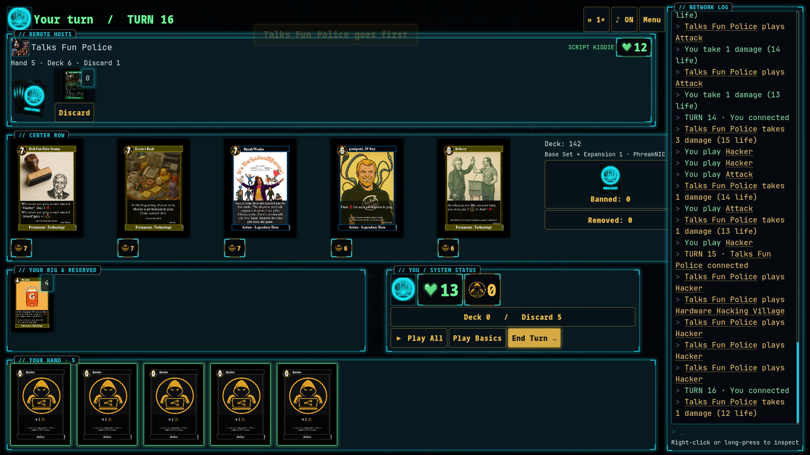
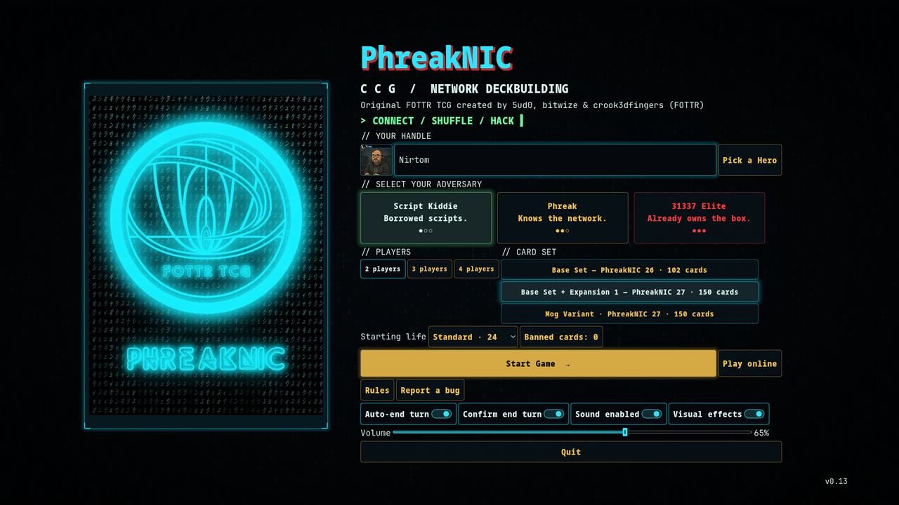

# PhreakNIC CCG

A digital version of the **FOTTR TCG: PhreakNIC** deck-building card game, built with Godot 4.7. Version **0.13**.

Original FOTTR TCG created by 5ud0, bitwize & crook3dfingers (FOTTR).





_Screenshots are from the current version and are refreshed with every release._

## Play in your browser
**[▶ Play PhreakNIC CCG now at phreaknic-ccg.net](https://phreaknic-ccg.net)**, or use the [GitHub Pages mirror](https://nirtom84.github.io/PhreakNIC-CCG/). Nothing to install. It runs in modern browsers on computers and phones; hold your phone sideways. It's tested in Chrome so far, and Firefox and Safari reports are welcome. The first visit downloads about 28 MB. Saves and settings are kept in that browser.

## Play online
Choose **Play online** on the main menu to play other people on the official server:
- **Open games:** browse the public games and join one with an open seat.
- **Create game:** make a public or invite-only room for 2–4 players. Fill seats with friends or bots, and pick the card set and starting life.
- **Join by code:** type a friend's four-character code. In a browser, an invite link like `phreaknic-ccg.net/join/CODE` opens an identity panel; pick a Hero or enter a handle, then press Join as your name (or Join anyway).

The server runs every game, so nobody can see cards they shouldn't. Your menu handle and Hero are used online.
**Leave game** keeps your seat: **Resume online game** reconnects, and a bot plays for you after two minutes away.
Online games need everyone on the same version of the game.

## Download & play (alpha)
The game is in **alpha testing**. Prefer an app? Grab the latest build from the [Releases page](https://github.com/Nirtom84/PhreakNIC-CCG/releases/latest):

| Platform | Download | How to run |
|---|---|---|
| Windows 10/11 (64-bit) | [PhreakNIC-CCG-windows.zip](https://github.com/Nirtom84/PhreakNIC-CCG/releases/latest/download/PhreakNIC-CCG-windows.zip) | Unzip and double-click the `.exe`. The app isn't code-signed yet, so Windows SmartScreen may warn you: choose **More info → Run anyway**. |
| Linux (x86_64) | [PhreakNIC-CCG-linux.zip](https://github.com/Nirtom84/PhreakNIC-CCG/releases/latest/download/PhreakNIC-CCG-linux.zip) | Unzip and run the `.x86_64` file. If it won't start, make it executable: `chmod +x PhreakNIC-CCG-*.x86_64`. |
| Android 7.0+ (64-bit) | [PhreakNIC-CCG-android.apk](https://github.com/Nirtom84/PhreakNIC-CCG/releases/latest/download/PhreakNIC-CCG-android.apk) | Open the file on your phone and allow your browser or file manager to install unknown apps. Plays in landscape. From v0.11 the APK is release-signed: uninstall an older version first. If Google Play Protect says the app is from an unknown developer, tap **Install anyway** (it's new, not unsafe; see [SECURITY.md](SECURITY.md) to verify the signature). |

Choose 2–4 players (you plus 1–3 bots), a bot level, the card set and the starting life, then start.
- **Your turn:** click a hand card to play it, or use **Play Basics** (Hackers and Attacks only) or **Play All**.
- **Buying:** click a Center Row card or your reserved card to open its card sheet. It shows the full card, its rules as text, and the **Buy** and **Reserve** buttons.
- **Abilities:** use the buttons on your permanents.
- **Ending:** press **End Turn**. It asks first if you still have moves left.
- **Reading cards:** hover or right-click any card to zoom. On a touch screen, tap to play or buy, press and hold any card to read it, and drag to scroll.
Your turn ends by itself once you have nothing left to do (switch **Auto-end turn** off if you'd rather press End Turn).
**Menu** (or Back / Escape) opens the in-game menu: options, rules, **Save game**, **Main menu** and **Exit**. The game also saves at the start of each of your turns and when you leave, and **Resume game** on the main menu picks it up again.
On the main menu you can type a handle or **Pick a Hero** to play as one of the Hero cards, with their art as your avatar.
Under **Card set**, choose **Base Set · PhreakNIC 26** (102 cards) **Base Set + Expansion 1 · PhreakNIC 27** (150 cards), or **Mog Variant · PhreakNIC 27** (150 cards, with 48 Mog illustrations). Starting life defaults to the official 24 for two players, or 10 per player with 3–4 players.

### Found a bug?
Press **Report a bug** on the main menu or in the in-game menu. It opens a GitHub bug report already filled in with your version, platform and the last moves of your game. You need a free GitHub account to submit it. You can also [open an issue](https://github.com/Nirtom84/PhreakNIC-CCG/issues/new/choose) directly and pick **Bug report** or **Card or rules problem**.

### Run from source
Install [Godot 4.7](https://godotengine.org/download) and run from the project folder:
```bash
godot4.7.1 --path .
```

### Bot difficulty
| Level | Plays like |
|---|---|
| Script Kiddie | Plays everything, buys the priciest card it can, random choices |
| Phreak | Values cards, plays draw first, makes sensible choices, uses paid abilities |
| 31337 Elite | Adds lethal checks, deck thinning, reserving/denying cards and combo hunting |

Games have 2–4 players: you and 1–3 bots at the chosen level. Who goes first is random.

## Rules
This is the **official** digital version of the FOTTR TCG. The game follows [reference/rules.md](reference/rules.md): the printed rules card, the official errata v1.1 from [tcg.fottr.io](https://tcg.fottr.io/) and the designer's rulings. bitwize compiled them, along with the audited card transcription in [reference/cards_transcribed.json](reference/cards_transcribed.json).
The in-game Rules screen has a player-friendly summary. Implementation notes are in [RULES_NOTES.md](RULES_NOTES.md), and the design and architecture in [DESIGN.md](DESIGN.md).

## Project layout
- `data/cards.json` — 152 original definitions plus five Mognet copy/effect definitions (cost, type, rules text, aliases, Legendary flag, and `set`: 2025 base, 2026 expansion, or 2026mog variant), checked against `reference/cards_transcribed.json` by the tests
- `reference/` — official rules, errata and rulings (`rules.md`), the audited card transcription and the set list
- `assets/cards/` — 600px card faces and the card back
- `scripts/core/` — rules engine (`rules.gd`), one effect handler per card (`effects.gd`)
- `scripts/ai/` — bots and difficulty levels
- `scripts/ui/`, `scenes/` — menu and game table

## Sound
Retro sounds have menu volume/mute controls and a table mute button. Regenerate the WAV files from the project root with `python3 tools/make_sounds.py`.

## Building Linux, Windows, Android and Web versions
```bash
tools/build_all.sh            # all four, into build/, then packaged into build/release/
tools/build_all.sh android    # or just one: linux | windows | android | web
tools/build_all.sh release    # zip the builds under stable names in build/release/ for a GitHub Release
```
- **Web**: `tools/build_all.sh web` produces a static site in `build/web/`; serve it over HTTP(S), rather than opening `file://`.
- **phreaknic-ccg.net**: `tools/deploy_site.sh` publishes `build/web/` to the Cloudflare Worker in `cloudflare/site/`. Because Cloudflare caps static files at 25 MiB, the ~40 MB engine file goes to an R2 bucket and the Worker streams it. The script needs `CLOUDFLARE_API_TOKEN` and `CLOUDFLARE_ACCOUNT_ID` in the environment, or a private loader script at `~/.config/phreaknic/cf-env.sh` that exports them. Credentials never go in the repo.
- **GitHub Pages**: `tools/deploy_pages.sh` publishes `build/web/` to the `gh-pages` branch, which GitHub serves at https://nirtom84.github.io/PhreakNIC-CCG/. The branch is replaced on every deploy, so old web builds don't pile up in the repo's history.
- **Linux**: `build/linux/PhreakNIC-CCG-v<version>.x86_64` — a single file, run it directly.
- **Windows**: `build/windows/PhreakNIC-CCG-v<version>.exe` — a single file, double-click it.
- **Android**: `build/android/PhreakNIC-CCG-v<version>.apk`, signed with the project release key when `~/.config/phreaknic/android-signing.sh` exists (maintainer only; it loads the keystore from outside the repo). Without it you get `PhreakNIC-CCG-v<version>-debug.apk`, signed with your own debug key. Install with `adb install` or by copying it to the phone (allow "install unknown apps").

One-time setup on the build machine: Godot 4.7.1 export templates in `~/.local/share/godot/export_templates/4.7.1.stable/`, JDK 17 (`~/.local/opt/jdk-17`), and the Android SDK in `~/Android/Sdk` with `platform-tools`, `build-tools;36.1.0` and `platforms;android-36`. Export settings live in `export_presets.cfg`.

## Online server
The game server is the headless Godot build (the `Server` export preset, `tools/build_all.sh server`), running in Cloudflare Containers behind the Worker in `cloudflare/online/`. It's deployed with `tools/deploy_online.sh` to https://online-01.phreaknic-ccg.net. See [cloudflare/online/README.md](cloudflare/online/README.md).
For development, point the game at another server with the `PHREAKNIC_SERVER` environment variable (for example `http://127.0.0.1:8788`) or the `game/online_server` key in `user://settings.cfg`.

## Tests
```bash
godot4.7.1 --headless --path . -s tests/sim.gd           # 450 bot-vs-bot games (all three card sets, 2-4 players), the rules scenarios and the official-rulings checks (rules_v08)
godot4.7.1 --headless --path . -s tests/online_ui_checks.gd # offline fake REST/room and real online table dialogs
godot4.7.1 --headless --path . -s tests/ui_smoke.gd      # table UI drives full turns
godot4.7.1 --headless --path . -s tests/ui_state_sync.gd # UI always matches engine state
godot4.7.1 --headless --path . -s tests/touch_checks.gd  # taps, long-press, drag scrolling, Back button
godot4.7.1 --headless --path . -s tests/v05_checks.gd    # auto-end turn, dialog sizing, wide screens, Hero avatars
godot4.7.1 --headless --path . -s tests/save_checks.gd   # save/resume round trips and the in-game menu
godot4.7.1 --headless --path . -s tests/v06_checks.gd    # 2025 / 2026 card sets
godot4.7.1 --headless --path . -s tests/v07_checks.gd    # browser version: hidden Quit/Exit, rotate prompt, save on leaving the page
godot4.7.1 --headless --path . -s tests/v08_checks.gd    # card sheet, Play Basics, end-turn confirmation, 3-4 players, starting life, bug report
godot4.7.1 --path . -s tools/screenshot.gd --resolution 1920x1080 -- out.png 8   # rendered screenshot
```

## Visuals and fonts
Neon HUD panels, terminal backgrounds and bundled fonts require no system fonts. The menu’s Visual effects switch disables animated backgrounds and decorative effects and is saved with sound settings. Card artwork is unchanged.

Fonts in `assets/fonts/`: JetBrains Mono Nerd Font (regular/bold, SIL Open Font License; `LICENSE-JetBrainsMono-OFL.txt`), Noto Sans Mono Condensed Black (`LICENSE-NotoSansMono.txt`), and Droid Sans Japanese (Apache 2.0; `NOTICE-DroidSansJapanese-Apache.txt`). The matrix background uses lightweight procedural glyphs.
